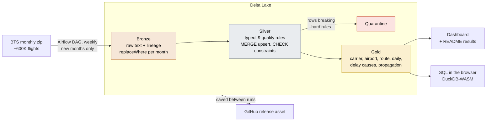

# Flight Delay Lakehouse: PySpark, Delta Lake & Airflow

[](https://github.com/dvskaff/flight-delay-lakehouse/actions/workflows/ci.yml)
[](https://github.com/dvskaff/flight-delay-lakehouse/actions/workflows/pipeline.yml)
 
 

* **Dashboard:** [live results, updated weekly](https://dvskaff.github.io/flight-delay-lakehouse/)
* **SQL:** [query the gold tables in your browser](https://dvskaff.github.io/flight-delay-lakehouse/sql.html)
* **Data:** [the Delta tables, saved after every run](https://github.com/dvskaff/flight-delay-lakehouse/releases/tag/lakehouse)

A medallion (bronze → silver → gold) lakehouse of every domestic flight reported to the U.S. Bureau of
Transportation Statistics (BTS), about 600,000 flights a month over a rolling 24 months. It's built with PySpark and
Delta Lake and orchestrated by an Apache Airflow DAG that GitHub Actions runs every week. Each run finds the newest
published month, loads only what is new, enforces data quality, and rebuilds the gold tables and the dashboard.

## Results

Rewritten automatically after every run.

<!-- RESULTS:START -->
_BTS on-time data 2024-09 to 2026-08 · 14,094,455 flights in silver · last run 2026-11-08 18:47 UTC_

| Last 12 months | Value |
|---|---|
| Flights | 7,049,869 |
| On-time arrivals (< 15 min late) | 77.3% (-2.1 pts vs. prior 12 months) |
| Cancelled | 1.9% |
| Most / least punctual carrier | Delta Air Lines 81.1% · JetBlue Airways 71.3% |
| Share of delay minutes from late-arriving aircraft | 40% |
| Next flight departs late after the plane arrived 60+ min late | 86% |

**Lake:** 14 Delta tables · silver 24 files, 637 MB, 10 recent versions in the log · CHECK constraints: key_present, origin_not_dest, positive_distance, valid_schedule_time · months loaded this run: none (no new BTS month)
<!-- RESULTS:END -->

## Query it yourself

The [SQL page](https://dvskaff.github.io/flight-delay-lakehouse/sql.html) loads every gold table, plus every flight of
the newest month from silver, into DuckDB running inside your browser (DuckDB-WASM, served by the site itself, so
nothing is sent to a server). Start from the examples (airlines ranked, best time of day to fly, one route month by
month, the longest delays, why flights were cancelled, how delays snowball) or write your own. The files are
re-exported from the Delta tables after every run, with the lake's column types and a description of every column.

## Architecture



<details><summary>Every task and table, step by step</summary>

```
BTS transtats: one zip per month (newest month found by probing; schema-drift check on every file)
      │
      ▼  Airflow DAG `flight_lakehouse` (dags/flight_lakehouse.py), weekly
 plan ──► ingest_month (mapped: one task per missing month) ──► build_silver ──► validate ──► build_gold ──► maintain ──► publish
      │
      ▼
 BRONZE  bronze/flights        raw values as text + lineage (source file, load time), partitioned by month;
                               a month is replaced atomically (replaceWhere), so re-loads are idempotent;
                               only the last 3 months are kept (raw files can be re-downloaded)
 SILVER  silver/flights        typed and renamed, 9 data-quality rules, de-duplicated on the natural key,
                               MERGE upsert (insert new, update changed by row hash, delete vanished rows),
                               Delta CHECK constraints, Z-ORDER by origin + carrier, rolling 24-month retention
         silver/quarantine     rows that broke a hard rule, with the rule names
 GOLD    carrier_month · airport_month · route_month · daily · hour_weekday · delay_causes ·
         delay_propagation (tail-number rotations) · dim_carrier · dim_airport
 OPS     load_log (one row per file) · dq_results (every rule, every load)
      │
      ▼
 GitHub Pages dashboard + this README + sql.html (DuckDB-WASM on exported gold tables)
 Delta tables saved as a release asset between runs
```

</details>

### Engineering details

* **Incremental and idempotent.** The plan task compares the rolling window with the months already in silver and
  loads only the missing ones. Any month can be re-loaded (`FLIGHTS_RELOAD=2025-03`) and the tables end up the same:
  the MERGE inserts, updates and deletes nothing.
* **Data quality as a gate.** Hard rules (keys present, origin ≠ destination, valid times, positive distance, date
  inside the file's month) send rows to quarantine, and the load stops before touching silver if more than 1% fail.
  Warning rules (cancelled flights have a reason, delay causes add up, plausible delays) are counted and shown.
  After every write, validation checks key uniqueness, the window and row-count reconciliation from bronze to silver.
* **Delta Lake features used:** ACID MERGE with `whenNotMatchedBySourceDelete`, `replaceWhere` partition overwrites,
  CHECK constraints, OPTIMIZE + Z-ORDER on the partitions written this run, VACUUM, table history (shown on the
  dashboard) and time travel.
* **Delay propagation.** A window function follows each aircraft (tail number) through its day and links every
  departure to the same plane's previous arrival.
* **Tests.** pytest on synthetic BTS-format files covers the transformations, quality rules, gold definitions,
  incremental runs, retention, idempotent re-loads and Delta constraint enforcement. It also runs the full Airflow DAG
  end to end with `dag.test()`.

## Repository layout

```
dags/flight_lakehouse.py   the Airflow DAG (also runnable directly: python dags/flight_lakehouse.py)
src/flights/               config · spark (session) · source (BTS download) · lake (Delta storage layer)
                           transform (bronze→silver, quality rules) · gold · pipeline (tasks) · report · readme
                           explore (exports gold for the browser and writes the SQL page)
                           fixture.py: SYNTHETIC files in the BTS layout for tests (pages built from it say so)
scripts/                   fetch_web_runtime.sh: fetches DuckDB-WASM from npm and bundles it for the SQL page
tests/                     source, transformations, gold, pipeline runs, DAG structure and an end-to-end DAG run
.github/workflows/         ci.yml (lint + tests on Delta) · pipeline.yml (weekly lakehouse run → GitHub Pages)
```

## Run it

Everything runs in GitHub Actions (**Actions → Lakehouse → Run workflow**). Locally (needs Java 17+):

```bash
pip install -r requirements-dev.txt
pytest -q                                            # Parquet mode, fully offline
LAKE_FORMAT=delta pytest -q                          # Delta mode (downloads the Delta jars from Maven once)
airflow db migrate && python dags/flight_lakehouse.py  # real BTS data through the Airflow DAG
```

Data: U.S. Bureau of Transportation Statistics, Reporting Carrier On-Time Performance (public domain).
Code: MIT license.
